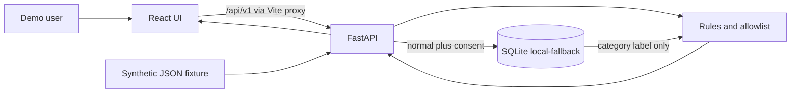

# Architecture

This file describes the code on `main`. Target-design notes in [docs/00-overall-architecture-report.md](docs/00-overall-architecture-report.md) still describe Jev and Backboard as part of the product path. Those calls are not in the running process.

Diagrams, preserved and still useful for the target shape:

- [docs/diagrams/architecture.mmd](docs/diagrams/architecture.mmd)
- [docs/diagrams/data-flow.mmd](docs/diagrams/data-flow.mmd)
- [docs/diagrams/review-sequence.mmd](docs/diagrams/review-sequence.mmd)
- [docs/diagrams/git-collaboration.mmd](docs/diagrams/git-collaboration.mmd)
- [docs/diagrams/threat-boundaries.mmd](docs/diagrams/threat-boundaries.mmd)
- [docs/diagrams/integration-order.mmd](docs/diagrams/integration-order.mmd)

The `.svg` files and `docs/index.html` are snapshots of that design. The Mermaid sources remain the editable diagrams. The memory node in `data-flow.mmd` now says SQLite is the store that runs.

## What runs

There is no arrow to Jev, Backboard, or Nessie. The modules exist and are not called.

## Modules

| Module | Path | Runtime behavior | Owner |
|---|---|---|---|
| React UI | `frontend/src/main.tsx`, `frontend/src/api.ts` | Loads health, transactions, alerts, and memories. Posts a confirmation. Renders the preview JSON it received | Ian |
| FastAPI app | `backend/app/main.py` | Loads the synthetic fixture once, opens SQLite, adds CORS and error handlers | Benson |
| Routes | `backend/app/api/routes.py` | Lists data, runs analysis, saves confirmations, reads memories back into analysis | Benson wires; Brian defines the analysis |
| Synthetic adapter | `backend/app/adapters/synthetic.py` | Reads `fixtures/synthetic-transactions.json` | Kenny |
| Nessie adapter | `backend/app/adapters/nessie.py` | Raises `NessieNotConfigured` | Kenny |
| Transaction model | `backend/app/schemas/transaction.py` | Canonical fields, `extra=forbid` | Kenny |
| API models | `backend/app/schemas/api.py` | Health, analysis, safe payload, memory | Benson, with Brian on payload fields |
| Privacy guard | `backend/app/services/ai/privacy.py` | Builds the eight-field allowlist and the inspector rows | Brian |
| Rules | `backend/app/services/ai/rules.py` | Duplicate, amount at least 250, subscription increase over 20 percent | Brian |
| Memory policy | `backend/app/services/ai/memory_policy.py` | Writes a category sentence and parses it back to `normal` or `unknown` | Brian |
| Jev client | `backend/app/services/ai/jev_client.py` | `NotImplementedError` | Brian |
| Backboard client | `backend/app/services/ai/backboard_client.py` | `NotImplementedError` | Brian |
| SQLite store | `backend/app/core/store.py` | Scoped to `demo-user-001`. Idempotent confirmation. Delete by memory id | Benson |
| Settings | `backend/app/core/config.py` | Loads `backend/.env`. Empty vendor keys | Benson |

## Data flow that exists today

1. `create_app` calls `load_transactions()` in the synthetic adapter. Eight `Transaction` objects stay in memory for the process.
2. `GET /api/v1/transactions` returns those objects. The React table shows merchant, category, date, and amount. That display is local. It is not an AI request.
3. `GET /api/v1/alerts` runs `analyze` for each transaction. A non-`none` result becomes an alert. The fixture produces three: StreamWave duplicate, Tech Harbor amount, FitFlow subscription increase.
4. `GET /api/v1/privacy/preview/{id}` builds `SafePayload` from the same functions. The inspector prints `inspection` and `safe_payload`. The UI does not construct a second payload.
5. Allowed payload fields are `merchant_category`, `amount_bucket`, `currency`, `local_day_part`, `same_category_same_amount_24h_count`, `is_subscription`, `subscription_delta_bucket`, and `prior_user_confirmation`.
6. Dropped before that object: transaction id, account token, merchant display, exact amount, exact timestamp, and any unknown field.
7. The user chooses `normal` or `review`. Memory is written only when the decision is `normal`, the consent box is checked, and `ALLOW_MEMORY_WRITE` is true.
8. The stored sentence is `The demo user explicitly confirmed a {category} alert as normal. Recheck future evidence.` The category is one of the allowlisted labels, or `other`.
9. The next alerts call, analysis call, and preview call read those sentences for the demo user. A matching category sets `prior_user_confirmation` to `normal` and adds an evidence line. `needs_human` stays true. Another category stays `unknown`.
10. `DELETE /api/v1/memories/{id}` removes that row. The following preview is `unknown` again.
11. `GET /api/v1/health` returns `data_mode=synthetic`, `analysis_mode=rules-only`, and `memory_mode=local-fallback` or `off`.

`review` and consent turned off do not write a sentence. The parser therefore never returns `review` from stored memory. The schema still allows that label for a future client.

## What is mocked

| Promised integration | Code | What a caller would see |
|---|---|---|
| Jev classification | Stub, not imported | Rules only. `provider_mode=rules-only`. `model_version=null` |
| Jev over HTTP or a Python SDK | Neither `httpx` nor `typesafe-sdk` is used | No request |
| Jev through Backboard | No | Backboard is a separate unused stub |
| Backboard memory, routing, or retrieval | Stub, not imported | SQLite sentence, `source=local-fallback` |
| Nessie customers, accounts, or purchases | Stub, not imported | `source=synthetic` on every fixture row |
| Authentication | Fixed `demo_user_id` | The browser cannot select another user |
| Hosting | None | Localhost ports 5173 and 8000 |

## Jev, when someone adds it

The intended call is Brian's direct client, not a Backboard route and not a local process.

- Remote API: `POST https://api.typesafe.ai/v1/systemone`.
- Auth header: `Authorization: Bearer <key>`.
- Body: a string or object `state` plus typed `questions`. For TrustLedger, `state` must be the existing `SafePayload` only.
- Model id: pin `jev-1.13.0` or the current id the team writes down. Do not rely on `jev-latest` without checking [the model page](https://docs.typesafe.ai/models).
- This repo's unused setting is `JEV_API_KEY`. The official SDK reads `TYPESAFE_API_KEY`. Pick one name in a reviewed settings change. Do not send the key to the browser.
- Official Python package `typesafe-sdk` is not installed. Adding it is an integrator lockfile change.

`docs/.env.example` mentions `https://jev-ai.org/api/v1` and `jev-1.13`. Those values are not loaded and do not match the TypeSafe quick start. Do not implement against them unless official TypeSafe documentation is updated and the team agrees.

## Backboard, when someone adds it

- Remote base URL in Backboard's docs: `https://app.backboard.io/api`.
- Auth header: `X-API-Key`.
- Product memory is per assistant. A demo must not share one assistant across real users. This MVP has one demo user.
- The only content eligible to send is the consented sentence already stored locally. Do not send the transaction.
- Delete must call Backboard's memory delete and the local row. If the remote delete fails, the UI must not say the memory is gone.
- Until that client exists, the running label remains `local-fallback`.

## Nessie, when someone adds it

- Public product entry: [api.nessieisreal.com](http://api.nessieisreal.com/).
- Kenny's adapter normalizes sandbox records into `Transaction` and drops raw ids before returning.
- Benson selects it from `main.py` only behind a failure path back to the fixture.
- Endpoint paths and the key's query or header placement are UNVERIFIED here because the stub makes no request. Confirm them on the Nessie documentation page before coding a URL.

## Security boundary

The browser holds no vendor key. Vendor keys, if later set, stay in `backend/.env`. The privacy boundary is the `SafePayload` constructor, not a comment in the UI. Details and the threat list: [docs/06-security-privacy-threat-model.md](docs/06-security-privacy-threat-model.md).

## Current project status

| Item | State | Owner | Priority | Next step | Done when |
|---|---|---|---|---|---|
| Synthetic load, 3 alerts, review, inspector | DONE | Shared | — | Keep it green | `check.sh` passes and the click path works |
| SQLite memory affects the next analysis | DONE | Brian content, Benson store | — | Merged in PR #3 | Preview shows `normal` only for that category, then `unknown` after delete |
| Jev live call | NOT STARTED | Brian | P1 | Direct System One call with the allowlist | Failed calls leave rules in place and the mode honest |
| Backboard live memory | NOT STARTED | Brian | P1 | Consent-gated write and delete | Local fallback remains labeled when the call fails |
| Nessie live read | NOT STARTED | Kenny | P1 | Read-only mapper plus synthetic fallback | CI passes with no key and makes no network call |
| Health and route wiring for those clients | NOT STARTED | Benson | P1 | Depends on the three clients | Mode flags flip only after a successful call |
| Frontend polish and small-screen pass | NOT STARTED | Ian | P1 | Use the current API | Demo path is usable without spoken help |
| Deployment | NOT STARTED | Benson | P2 | No config exists | A URL and SHA are written down, with no secrets in the repo |
| Authentication | NOT STARTED | Benson | P2 | Out of the local demo unless the team cuts scope elsewhere | Not required for the synthetic localhost demo |
| Branch `backend` doc and line endings | IN PROGRESS | Benson | P2 | Open a PR from that branch when ready | `.gitattributes` and `backend/README.md` reviewed without replacing this role doc |
| CI on `main` | DONE | Benson | P0 | Re-run on each PR | The PR #3 merge run `39075769257` passed |
| Branch protection | UNVERIFIED | Benson | P1 | Private-repo API returned HTTP 403 | Settings show required CI, or the team accepts the limit in writing |

No task above is blocked on a missing repository path. Live work is blocked only by an empty key in `backend/.env` and by the stub functions. Do not put those keys in Git.
