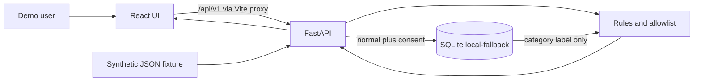

# Architecture

This file describes the selected architecture. Jev is reached through Backboard's System One API, not through `https://api.typesafe.ai`. The direct TypeSafe route remains an unused option documented by TypeSafe. Target-design notes in [docs/00-overall-architecture-report.md](docs/00-overall-architecture-report.md) still describe the product shape.

Diagrams, preserved and still useful for the target shape:

- [docs/diagrams/architecture.mmd](docs/diagrams/architecture.mmd)
- [docs/diagrams/data-flow.mmd](docs/diagrams/data-flow.mmd)
- [docs/diagrams/review-sequence.mmd](docs/diagrams/review-sequence.mmd)
- [docs/diagrams/git-collaboration.mmd](docs/diagrams/git-collaboration.mmd)
- [docs/diagrams/threat-boundaries.mmd](docs/diagrams/threat-boundaries.mmd)
- [docs/diagrams/integration-order.mmd](docs/diagrams/integration-order.mmd)

The `.svg` files and `docs/index.html` are snapshots of that design. The Mermaid sources remain the editable diagrams. The memory node in `data-flow.mmd` now says SQLite is the store that runs.

## What runs



Nessie is not called. Jev is called only through Backboard, and only when a server-side key is present. Memory writes stay in SQLite.

## Modules

| Module | Path | Runtime behavior | Owner |
|---|---|---|---|
| React UI | `frontend/src/main.tsx`, `frontend/src/api.ts` | Loads health, transactions, alerts, and memories. Posts a confirmation. Renders the preview JSON it received | Ian |
| FastAPI app | `backend/app/main.py` | Loads the synthetic fixture once, opens SQLite, adds CORS and error handlers | Benson |
| Routes | `backend/app/api/routes.py` | Lists data, runs analysis, saves confirmations, reads memories back into analysis | Benson wires; Brian defines the analysis |
| Synthetic adapter | `backend/app/adapters/synthetic.py` | Reads `fixtures/synthetic-transactions.json` | Kenny |
| Nessie adapter | `backend/app/adapters/nessie.py` | Raises `NessieNotConfigured` | Kenny |
| Transaction model | `backend/app/schemas/transaction.py` | Canonical fields, `extra=forbid` | Kenny |
| API models | `backend/app/schemas/api.py` | Health, analysis, safe payload, memory | Benson, with Brian on payload fields |
| Privacy guard | `backend/app/services/ai/privacy.py` | Builds the eight-field allowlist and the inspector rows | Brian |
| Rules | `backend/app/services/ai/rules.py` | Duplicate, amount at least 250, subscription increase over 20 percent | Brian |
| Memory policy | `backend/app/services/ai/memory_policy.py` | Writes a category sentence and parses it back to `normal` or `unknown` | Brian |
| Jev client | `backend/app/services/ai/jev_client.py` | Backboard `POST /threads/messages` when `BACKBOARD_API_KEY` is set | Brian |
| Decision merge | `backend/app/services/ai/decision.py` | Keeps the rule result. Labels Jev only after a valid response | Brian |
| Backboard memory client | `backend/app/services/ai/backboard_client.py` | `NotImplementedError`. Inference does not enable memory | Brian |
| SQLite store | `backend/app/core/store.py` | Scoped to `demo-user-001`. Idempotent confirmation. Delete by memory id | Benson |
| Settings | `backend/app/core/config.py` | Loads `backend/.env`. Empty vendor keys | Benson |

## Data flow that exists today

1. `create_app` calls `load_transactions()` in the synthetic adapter. Eight `Transaction` objects stay in memory for the process.
2. `GET /api/v1/transactions` returns those objects. The React table shows merchant, category, date, and amount. That display is local. It is not an AI request.
3. `GET /api/v1/alerts` runs `analyze` for each transaction. A non-`none` result becomes an alert. The fixture produces three: StreamWave duplicate, Tech Harbor amount, FitFlow subscription increase.
4. `GET /api/v1/privacy/preview/{id}` builds `SafePayload` from the same functions. The inspector prints `inspection` and `safe_payload`. The UI does not construct a second payload.
5. Allowed payload fields are `merchant_category`, `amount_bucket`, `currency`, `local_day_part`, `same_category_same_amount_24h_count`, `is_subscription`, `subscription_delta_bucket`, and `prior_user_confirmation`.
6. Dropped before that object: transaction id, account token, merchant display, exact amount, exact timestamp, and any unknown field.
7. The user chooses `normal` or `review`. Memory is written only when the decision is `normal`, the consent box is checked, and `ALLOW_MEMORY_WRITE` is true.
8. The stored sentence is `The demo user explicitly confirmed a {category} alert as normal. Recheck future evidence.` The category is one of the allowlisted labels, or `other`.
9. The next alerts call, analysis call, and preview call read those sentences for the demo user. A matching category sets `prior_user_confirmation` to `normal` and adds an evidence line. `needs_human` stays true. Another category stays `unknown`.
10. `DELETE /api/v1/memories/{id}` removes that row. The following preview is `unknown` again.
11. `GET /api/v1/health` returns `data_mode=synthetic`, `analysis_mode=rules-only`, and `memory_mode=local-fallback` or `off`.

`review` and consent turned off do not write a sentence. The parser therefore never returns `review` from stored memory. The schema still allows that label for a future client.

## What is mocked

| Promised integration | Code | What a caller would see |
|---|---|---|
| Jev through Backboard | `POST https://app.backboard.io/api/threads/messages` with `httpx` | `provider_mode=rules+jev-live` only after a parsed `system_one.answers` |
| Direct TypeSafe API | Not used | No request to `api.typesafe.ai` |
| Missing key | No outbound call | `provider_mode=rules-only` |
| Backboard timeout, non-200, or invalid answers | Rules kept | `provider_mode=degraded`. Not described as live Jev |
| Backboard memory | Stub | SQLite sentence, `source=local-fallback`. The inference request omits `memory` |
| Nessie | Stub | `source=synthetic` |
| Authentication | Fixed `demo-user-001` | The browser cannot select another user |
| Hosting | None | Localhost ports 5173 and 8000 |

## Selected Jev route

Official reference: [Backboard System One](https://docs.backboard.io/concepts/system-one).

```text
React → FastAPI → privacy allowlist → Backboard REST → TypeSafe Jev
```

The client sends:

- `POST https://app.backboard.io/api/threads/messages`
- Header `X-API-Key: $BACKBOARD_API_KEY`. This is the Backboard key. `JEV_API_KEY` is not sent.
- `llm_provider` = `typesafe`
- `model_name` = `jev-latest`
- `stream` = `false`
- `system_one.state` = the eight `SafePayload` fields
- `system_one.questions` = `pattern` (choice) and `needs_review` (noul)
- No `thread_id`, so each decision starts a new thread
- No `memory` parameter, so assistant memory stays off

`system_one.model` in the response is the resolved model, such as `jev-1.13.0`. The code stores that string in `model_version`. The rule's `alert_type`, severity, and `confidence=1.0` stay as they were. A Jev label is one extra evidence line. `needs_human` stays true when the rule flagged the transaction.

`GET /api/v1/alerts` calls Jev only for rows the rules already flag. `POST /api/v1/analyses` calls Jev for the requested transaction when the key is set. Health reports `rules+jev-live` or `degraded` only after one of those calls records that outcome. A key by itself does not make health say live.

### Optional direct TypeSafe route

TypeSafe also documents `POST https://api.typesafe.ai/v1/systemone` with `Authorization: Bearer` and `TYPESAFE_API_KEY`. TrustLedger does not call that URL and does not install `typesafe-sdk`. Do not switch to it unless the team replaces this decision. `docs/.env.example` values `JEV_BASE_URL=https://jev-ai.org/api/v1` and `JEV_MODEL=jev-1.13` are still unread leftovers.

## Backboard memory plan

Persistent Backboard memory is not implemented. The inference call must not be treated as a memory write.

| Behavior | Required design | Current code |
|---|---|---|
| Isolation | One server-side assistant for `demo-user-001`. The browser cannot choose it. Do not share that assistant with another person | Not stored. No `assistant_id` is sent |
| Consent | Write only when the decision is `normal`, consent is checked, and `ALLOW_MEMORY_WRITE=true` | SQLite uses those three gates |
| Content | The existing category sentence only. No merchant, amount, id, or raw transaction | SQLite stores that sentence |
| Retrieval | Read that assistant's memories and map them with `prior_confirmation`. On failure, keep using SQLite and do not claim `backboard-live` | SQLite summaries feed the next analysis |
| Deletion | Delete the remote memory and the local row. If the remote delete fails, keep the local row and show a failure | Local delete only |
| Failure | A failed remote write does not undo the confirmation. Leave `memory_status` as failed or skipped and keep `source=local-fallback` | Confirmation still commits locally |

`backboard_client.add_memory` still raises `NotImplementedError`. Do not point the UI at `backboard` until a delete and a read both succeed.

## Nessie, when someone adds it

- Public product entry: [api.nessieisreal.com](http://api.nessieisreal.com/).
- Kenny's adapter normalizes sandbox records into `Transaction` and drops raw ids before returning.
- Benson selects it from `main.py` only behind a failure path back to the fixture.
- Endpoint paths and the key's query or header placement are UNVERIFIED here because the stub makes no request. Confirm them on the Nessie documentation page before coding a URL.

## Security boundary

The browser holds no vendor key. Vendor keys, if later set, stay in `backend/.env`. The privacy boundary is the `SafePayload` constructor, not a comment in the UI. Details and the threat list: [docs/06-security-privacy-threat-model.md](docs/06-security-privacy-threat-model.md).

## Current project status

| Item | State | Owner | Priority | Next step | Done when |
|---|---|---|---|---|---|
| Synthetic load, 3 alerts, review, inspector | DONE | Shared | — | Keep it green | `check.sh` passes and the click path works |
| SQLite memory affects the next analysis | DONE | Brian content, Benson store | — | Merged in PR #3 | Preview shows `normal` only for that category, then `unknown` after delete |
| Jev through Backboard | IMPLEMENTED behind `BACKBOARD_API_KEY` | Brian | P1 | A real response must be seen before calling the demo live | Mocked tests cover success and failure. A missing key stays `rules-only` |
| Backboard persistent memory | NOT STARTED | Brian | P1 | Consent, isolation, read, and delete as in the plan above | Local fallback remains the only memory write |
| Nessie live read | NOT STARTED | Kenny | P1 | Read-only mapper plus synthetic fallback | CI passes with no key and makes no network call |
| Health mode after a Jev attempt | DONE | Benson's route records Brian's result | `rules+jev-live` or `degraded` only after a call. Nessie and memory modes are unchanged |
| Frontend polish and small-screen pass | NOT STARTED | Ian | P1 | Use the current API | Demo path is usable without spoken help |
| Deployment | NOT STARTED | Benson | P2 | No config exists | A URL and SHA are written down, with no secrets in the repo |
| Authentication | NOT STARTED | Benson | P2 | Out of the local demo unless the team cuts scope elsewhere | Not required for the synthetic localhost demo |
| Branch `backend` doc and line endings | IN PROGRESS | Benson | P2 | Open a PR from that branch when ready | `.gitattributes` and `backend/README.md` reviewed without replacing this role doc |
| CI on `main` | DONE | Benson | P0 | Re-run on each PR | The PR #3 merge run `39075769257` passed |
| Branch protection | UNVERIFIED | Benson | P1 | Private-repo API returned HTTP 403 | Settings show required CI, or the team accepts the limit in writing |

No task above is blocked on a missing repository path. Live work is blocked only by an empty key in `backend/.env` and by the stub functions. Do not put those keys in Git.
