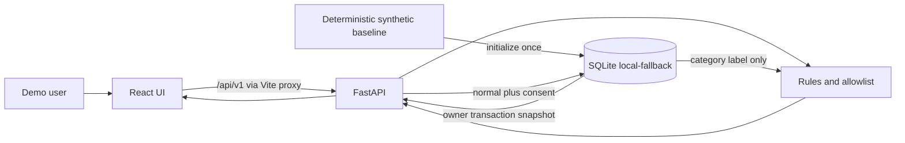

# Architecture

This file describes the selected architecture. Jev is reached through Backboard's System One API, not through `https://api.typesafe.ai`. The direct TypeSafe route remains an unused option documented by TypeSafe. Target-design notes in [docs/00-overall-architecture-report.md](docs/00-overall-architecture-report.md) still describe the product shape.

Diagrams, preserved and still useful for the target shape:

- [docs/diagrams/architecture.mmd](docs/diagrams/architecture.mmd)
- [docs/diagrams/data-flow.mmd](docs/diagrams/data-flow.mmd)
- [docs/diagrams/review-sequence.mmd](docs/diagrams/review-sequence.mmd)
- [docs/diagrams/git-collaboration.mmd](docs/diagrams/git-collaboration.mmd)
- [docs/diagrams/threat-boundaries.mmd](docs/diagrams/threat-boundaries.mmd)
- [docs/diagrams/integration-order.mmd](docs/diagrams/integration-order.mmd)

The `.svg` files and `docs/index.html` are snapshots of that design. The Mermaid sources remain the editable diagrams. The memory node in `data-flow.mmd` now says SQLite is the store that runs.

## What runs



The dashboard uses SQLite synthetic data. Separate Admin operations expose six allowlisted Nessie reads with backend-only IDs and status/time-only history; the explicit baseline CLI reads normalized SQLite fixtures. Jev uses Backboard with inference memory explicitly off. Consented memory uses SQLite alone without a key, or explicit Backboard CRUD with a durable local recovery index.

## Modules

| Module | Path | Runtime behavior | Owner |
|---|---|---|---|
| React UI | `frontend/src/main.tsx`, `frontend/src/api.ts` | Loads health, transactions, alerts, and memories. Posts a confirmation. Renders the preview JSON it received | Ian |
| FastAPI app | `backend/app/main.py` | Opens SQLite, initializes synthetic rows once, adds CORS and safe error handlers | Benson |
| Routes | `backend/app/api/routes.py` | Lists data, runs analysis, saves confirmations, reads memories back into analysis | Benson wires; Brian defines the analysis |
| Synthetic adapter | `backend/app/adapters/synthetic.py` | Initializes and reads canonical SQLite transactions; JSON files are offline goldens | Kenny |
| Nessie adapter | `backend/app/adapters/nessie.py` | Allowlisted sandbox reads and explicit baseline setup; dashboard adapter remains unimplemented | Kenny |
| Transaction model | `backend/app/schemas/transaction.py` | Canonical fields, `extra=forbid` | Kenny |
| API models | `backend/app/schemas/api.py` | Health, analysis, safe payload, memory | Benson, with Brian on payload fields |
| Privacy guard | `backend/app/services/ai/privacy.py` | Builds the eight-field allowlist and the inspector rows | Brian |
| Rules | `backend/app/services/ai/rules.py` | Scoped duplicate/subscription rules and preceding30-day category median; sparse baseline fallback250 | Brian |
| Memory policy | `backend/app/services/ai/memory_policy.py` | Writes a category sentence and parses it back to `normal` or `unknown` | Brian |
| Jev client | `backend/app/services/ai/jev_client.py` | Backboard `POST /threads/messages` when `BACKBOARD_API_KEY` is set | Brian |
| Decision merge | `backend/app/services/ai/decision.py` | Keeps the rule result. Labels Jev only after a valid response | Brian |
| Backboard memory client | `backend/app/services/ai/backboard_client.py` | Explicit allowlisted memory CRUD; no inference memory | Brian |
| SQLite store | `backend/app/core/store.py` | Scoped to `demo-user-001`. Idempotent confirmation. Delete by memory id | Benson |
| Settings | `backend/app/core/config.py` | Loads `backend/.env`. Empty vendor keys | Benson |

## Data flow that exists today

1. `create_app` initializes eight canonical synthetic transactions in SQLite only for an uninitialized owner. Restart preserves stored edits and an intentionally empty initialized set.
2. Each request reads one validated owner-scoped transaction snapshot from SQLite. The React table shows merchant, category, date, and amount locally; it is not an AI request.
3. `GET /api/v1/alerts` runs `analyze` for each transaction. A non-`none` result becomes an alert. The fixture produces three: StreamWave duplicate, Tech Harbor amount, FitFlow subscription increase.
4. `GET /api/v1/privacy/preview/{id}` builds `SafePayload` from the same functions. The inspector prints `inspection` and `safe_payload`. The UI does not construct a second payload.
5. Allowed payload fields are `merchant_category`, `amount_bucket`, `currency`, `local_day_part`, `same_category_same_amount_24h_count`, `is_subscription`, `subscription_delta_bucket`, and `prior_user_confirmation`.
6. Dropped before that object: transaction id, account token, merchant display, exact amount, exact timestamp, and any unknown field.
7. The user chooses `normal` or `review`. Memory is written only when the decision is `normal`, the consent box is checked, and `ALLOW_MEMORY_WRITE` is true.
8. The stored sentence is `The demo user explicitly confirmed a {category} alert as normal. Recheck future evidence.` The category is one of the allowlisted labels, or `other`.
9. The next alerts call, analysis call, and preview call read those sentences for the demo user. A matching category sets `prior_user_confirmation` to `normal` and adds an evidence line. `needs_human` stays true. Another category stays `unknown`.
10. A confirmed memory delete removes a remote fact first when applicable, then its local index. Failure returns502 and retains the row. A deleted preference is never reimported from orphan remote rows.
11. Health always reports synthetic dashboard data; analysis/memory modes reflect parsed provider results, configured memory-off or labelled local fallback. Either degraded provider outcome degrades status.

`review` and consent turned off do not write a sentence. The parser therefore never returns `review` from stored memory. The schema still allows that label for a future client.

## What is mocked

| Promised integration | Code | What a caller would see |
|---|---|---|
| Jev through Backboard | `POST https://app.backboard.io/api/threads/messages` with `httpx` | `provider_mode=rules+jev-live` only after a parsed `system_one.answers` |
| Direct TypeSafe API | Not used | No request to `api.typesafe.ai` |
| Missing key | No outbound call | `provider_mode=rules-only` |
| Backboard timeout, non-200, or invalid answers | Rules kept | `provider_mode=degraded`. Not described as live Jev |
| Backboard memory | Explicit CRUD, mocked in CI | SQLite fallback without key; pending/degraded on uncertain writes |
| Nessie | Separate Admin/CLI, mocked in CI | Dashboard remains synthetic; no automatic sandbox import |
| Authentication | Fixed `demo-user-001` | The browser cannot select another user |
| Hosting | None | Localhost ports 5173 and 8000 |

## Selected Jev route

Official reference: [Backboard System One](https://docs.backboard.io/concepts/system-one).

```text
React → FastAPI → privacy allowlist → Backboard REST → TypeSafe Jev
```

The client sends:

- `POST https://app.backboard.io/api/threads/messages`
- Header `X-API-Key: $BACKBOARD_API_KEY`. This is the Backboard key. `JEV_API_KEY` is not sent.
- `llm_provider` = `typesafe`
- `model_name` = `jev-latest`
- `stream` = `false`
- `system_one.state` = the eight `SafePayload` fields
- `system_one.questions` = `pattern` (choice), `needs_review` (noul) and `severity` (fractional score with legend)
- No `thread_id`, so each decision starts a new thread
- Explicit `memory=off`; client timeout5s

The resolved `system_one.model` must match the configured acceptance version `jev-1.13.0`; invalid model/schema/content falls back to degraded rules. This is an acceptance guard, not live validation. Rule severity and confidence remain authoritative, and uncertain model review still requires a person.

`GET /api/v1/alerts` calls Jev only for rows the rules already flag. `POST /api/v1/analyses` calls Jev for the requested transaction when the key is set. Health reports `rules+jev-live` or `degraded` only after one of those calls records that outcome. A key by itself does not make health say live.

### Optional direct TypeSafe route

TypeSafe also documents `POST https://api.typesafe.ai/v1/systemone` with `Authorization: Bearer` and `TYPESAFE_API_KEY`. TrustLedger does not call that URL and does not install `typesafe-sdk`. Do not switch to it unless the team replaces this decision. `docs/.env.example` values `JEV_BASE_URL=https://jev-ai.org/api/v1` and `JEV_MODEL=jev-1.13` are still unread leftovers.

## Backboard memory

Persistent memory is explicit CRUD. The Jev request explicitly sets `memory=off`, so classification does not write assistant memory.

The local map is one `assistant_id` per demo owner, created with `POST /assistants` and reused. The browser cannot choose it. The create body is a fixed name and system prompt, with no owner id and no transaction text.

| Behavior | What the code does |
|---|---|
| Isolation | SQLite table `assistants` stores the first id for that owner. Later reads and deletes use only that id |
| Consent | Remote and local writes run only when the decision is `normal`, consent is checked, and `ALLOW_MEMORY_WRITE=true` |
| Content | The category sentence only. `add_memory` rejects any other text before the request |
| Retrieval | Only locally indexed approved sentences affect analysis. A complete remote list validates availability/schema; orphan vendor facts are never imported |
| Deletion | A `backboard` row is deleted remotely first. HTTP 200 with `success: true`, or HTTP 404 when it is already gone, then deletes the local row. `success: false` or another failed call returns 502 and keeps the row |
| Failure | Confirmation commits first. A durable preparing/pending job claims the sentence before reading its remote-ID baseline and before POST. Definite rejection may keep a failed local fallback; lost acknowledgements remain pending/degraded, with no automatic POST retry |
| Recovery | Reconcile exactly one new matching fact excluding all baseline IDs. SQLite serializes same-sentence active jobs and enforces unique remote identity. Deletion is terminal; a delayed create acknowledgement cannot restore its local index |
| No key | No memory HTTP call. SQLite only, `source=local-fallback`, health `local-fallback` |

Health reports `backboard-live` only after a memory call in this process returns a parsed success. A key by itself does not. A failed memory call sets `degraded`.

Live check on 17 October 2026, against `https://app.backboard.io/api` with `X-API-Key`: assistant create (HTTP 200), memory add (HTTP 201), get, list, same-owner reuse, two-owner isolation, a second process, restart of this API, and assistant delete (HTTP 200) all succeeded. The stored text was the approved category sentence. Search is implemented and was not used to decide `prior_confirmation`. An invalid key returns the code `rejected`. Missing key, HTTP 429, HTTP 5xx, and timeout are mocked and do not say the write succeeded. Default pytest does not make these calls. Set `BACKBOARD_LIVE_TEST=1` to run `backend/tests/integration/test_backboard_live.py`.

The same account returned HTTP 402 `Insufficient credits for System One` for Jev. `review` keeps the rule analysis and sets `provider_mode=degraded`. Memory CRUD does not use that inference call. Do not buy credits or enable auto-reload. `GET /api/v1/alerts` and a confirmation both call Jev for rows the rules already flag, so a successful memory write can sit next to `analysis_mode=degraded`. After a restart, health stays `rules-only` and `local-fallback` until this process actually calls Jev or reads memory.

## Nessie scope

- Public product entry: [api.nessieisreal.com](http://api.nessieisreal.com/).
- The dashboard purchase-to-Transaction adapter remains an extension point; existing synthetic behavior is preserved.
- Admin resolves owner/key-scoped local customer/account codes to raw IDs in the backend and returns safe projected fields only. No raw response is persisted. The user approved removing content comparison.
- The baseline-only CLI preserves deterministic dataset identity, opening balances, parent mappings and pending-before-POST recovery. This update uses isolated verification and does not repeat historical live calls.

## Security boundary

The browser holds no vendor key. Vendor keys, if later set, stay in `backend/.env`. The privacy boundary is the `SafePayload` constructor, not a comment in the UI. Details and the threat list: [docs/06-security-privacy-threat-model.md](docs/06-security-privacy-threat-model.md).

## Current project status

| Item | State | Owner | Priority | Next step | Done when |
|---|---|---|---|---|---|
| Synthetic load, 3 alerts, review, inspector | DONE | Shared | — | Keep it green | `check.sh` passes and the click path works |
| SQLite memory affects the next analysis | DONE | Brian content, Benson store | — | Merged in PR #3 | Preview shows `normal` only for that category, then `unknown` after delete |
| Jev through Backboard | IMPLEMENTED behind `BACKBOARD_API_KEY` | Brian | P1 | This account returns HTTP 402 for System One. Do not buy credits | Mocked tests cover success and failure. A missing key stays `rules-only`. HTTP 402 stays `degraded` |
| Backboard persistent memory | VERIFIED live on 17 October 2026 | Brian, with Benson on the route and store | — | Keep CI mocked. Re-run only with `BACKBOARD_LIVE_TEST=1` | Create, store, retrieve, reuse, isolation, restart, and delete succeeded. No key stays `local-fallback` |
| Nessie Admin reads / baseline CLI | IMPLEMENTED separately from dashboard | Kenny | P1 | Owner review; dashboard mapper remains an extension point | CI passes with no key and makes no network call |
| Health mode after a provider attempt | DONE | Benson's route records Brian's result | — | `rules+jev-live`, `backboard-live`, or `degraded` only after a call | A key alone changes neither mode |
| Frontend polish and small-screen pass | NOT STARTED | Ian | P1 | Use the current API | Demo path is usable without spoken help |
| Deployment | NOT STARTED | Benson | P2 | No config exists | A URL and SHA are written down, with no secrets in the repo |
| Authentication | NOT STARTED | Benson | P2 | Out of the local demo unless the team cuts scope elsewhere | Not required for the synthetic localhost demo |
| Branch `backend` doc and line endings | IN PROGRESS | Benson | P2 | Open a PR from that branch when ready | `.gitattributes` and `backend/README.md` reviewed without replacing this role doc |
| CI on `main` | DONE | Benson | P0 | Re-run on each PR | The PR #3 merge run `39075769257` passed |
| Branch protection | UNVERIFIED | Benson | P1 | Private-repo API returned HTTP 403 | Settings show required CI, or the team accepts the limit in writing |

Backboard memory CRUD was verified live. Jev System One was not: this account returns HTTP 402, and the demo must not describe that failure as live classification. Pending memory writes that never become observable require manual reconciliation. Do not put keys in Git.
