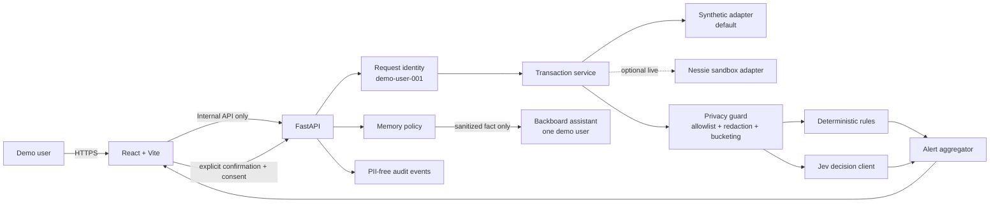

# TrustLedger 總體架構報告

**版本：** Technica 2026 B2C MVP  
**截止：** 2026-10-18 12:00 EDT  
**資料政策：** 僅合成資料／Nessie sandbox mock data；零真實金融資料

## 1. 一句話產品故事

TrustLedger 是一個 privacy-first 的個人金融安全助手：它找出可能的重複扣款、異常金額與訂閱變化，讓使用者看見實際送給 AI 的最小化資料，並且只在使用者明確確認後記住必要偏好。

## 2. MVP 邊界

### 必做

- B2C 單一合成 demo user。
- 交易列表、摘要與 alert detail。
- deterministic rules：duplicate、high amount、subscription change 至少兩種真正運作。
- Jev：對已最小化的 feature payload 做 bounded decision；失敗時 rules 仍可工作。
- Backboard：使用者確認後才寫入 sanitized memory；可檢視與刪除。
- Privacy Inspector：顯示「原始欄位 → 移除／轉換 → 實際 outbound payload」。畫面必須由同一個 serializer 產生，不能只是手畫示意。
- 人工確認：`normal` 或 `review`，不得自動封鎖交易或聲稱詐欺已成立。
- 明確的 live/mock/degraded 狀態。

### 不做

- B2B 銀行後台、多租戶管理、RBAC 管理介面。
- 真實銀行連線、付款、轉帳或帳號登入。
- 投資建議、信用決策、詐欺自動處置。
- 完整 authentication provider、KYC、PCI、SOC 2 或監管合規。
- 自訓模型、multi-agent orchestration、同態加密或 confidential computing。

## 3. 產品成功路徑

1. 使用者看到合成交易。
2. 系統標記兩筆同日同類別同金額的 streaming transaction。
3. 使用者開啟 alert，看到 rules 證據、Jev bounded classification 與 confidence。
4. Privacy Inspector 顯示姓名、地址、帳號、原始 merchant label 未送出；只送類別、金額區間、時間特徵與 duplicate count。
5. 使用者選擇 `正常交易`，勾選同意記憶。
6. 後端將最小化的 confirmation memory 寫入該 demo user 專用 Backboard assistant。
7. 重新分析相似案例時顯示「參考過去確認」，但低信心或金額顯著不同仍要求人工確認。

## 4. 邏輯架構



完整可編輯來源：[diagrams/architecture.mmd](diagrams/architecture.mmd)。

## 5. 信任邊界與資料分級

| 分級 | 例子 | MVP 位置 | 可送外部 AI？ |
|---|---|---|---|
| S0 Public | category enum、文件 | repo/browser | 可以 |
| S1 Demo internal | synthetic transaction id、alert id | browser/backend | 只在有必要且 tokenized 後 |
| S2 Sensitive-like | 合成姓名、地址、帳號、原始 merchant、精確時間/金額組合 | backend raw adapter | **不可以** |
| S3 Secret | Nessie/Jev/Backboard keys、deploy token | backend secret store | **絕對不可以** |

即使資料是合成的，也用真實系統的標準處理，讓 security demo 能反映合理設計。對外簡報必須說明「這些都是合成／sandbox 資料」。

## 6. Canonical transaction model

所有 data adapters 都轉成同一個內部模型；React 不依賴 Nessie 原始 schema。

```json
{
  "id": "txn_syn_001",
  "occurred_at": "2026-10-17T14:03:00-04:00",
  "amount": 11.99,
  "currency": "USD",
  "direction": "debit",
  "merchant_display": "StreamWave",
  "merchant_category": "streaming",
  "source": "synthetic",
  "account_token": "acct_demo_a1",
  "is_subscription": true
}
```

`merchant_display` 與 `account_token` 可回到自家 UI，但不可進 Jev/Backboard outbound payload。送 AI 前轉成：

```json
{
  "merchant_category": "streaming",
  "amount_bucket": "10-25",
  "currency": "USD",
  "local_day_part": "afternoon",
  "same_category_same_amount_24h_count": 2,
  "is_subscription": true,
  "subscription_delta_bucket": "none",
  "prior_user_confirmation": "unknown"
}
```

## 7. 分析策略

### Layer A — deterministic rules（可解釋 baseline）

- duplicate candidate：同一使用者、同類別、同金額、24 小時內至少 2 筆。
- high amount：金額大於合成使用者過去 30 天同類別中位數的 3 倍，且至少大於 USD 100。
- subscription change：相同訂閱類別相較上次增加超過 20%。

閾值是 demo policy，不是金融判定；集中在一個 config 檔，PR 中可審查。

### Layer B — Jev bounded decision

把已最小化的 feature object 當 `state`，一次詢問最多三個獨立問題：

- `alert_type`：`duplicate`、`amount_anomaly`、`subscription_change`、`none`。
- `needs_human`：`noul` probability。
- `severity`：`low`、`medium`、`high` 的 ordered `score`。

Jev 官方 contract 已確認 `POST /api/v1/systemone/`、`choice` criteria 為 object、`score` criteria 為 array、回應含 probability distribution。正式 request 由 AI Engineer 依最新官方文件實作；此文件只固定內部 DTO 與安全 policy。

### Layer C — human confirmation

- `normal`：使用者確認正常；如 consent=true，才寫 sanitized memory。
- `review`：使用者想後續檢查；只寫本地 alert status，預設不寫 Backboard。
- 任何低信心、vendor error 或新型態案例都不自動處置。

## 8. Backboard memory policy

Backboard 官方文件說 memory 是 assistant scope 且跨 threads。MVP 的安全決策：

- 只支援一位 `demo-user-001`，使用專用 assistant。
- 禁止把多位使用者的 threads 放進同一 assistant。
- `ALLOW_MEMORY_WRITE=false` 為預設；Demo 前由 backend owner 顯式開啟。
- 只儲存經使用者確認的抽象事實，例如：`User confirmed that two streaming-category charges in one day can be normal for this demo profile.`
- 不儲存姓名、account token、transaction id、精確金額、精確日期、merchant display 或原始 JSON。
- UI 提供 memory list/delete；Demo 後執行 deletion checklist。

## 9. Privacy Inspector 的 source-of-truth

後端的 privacy serializer 回傳同一份物件供兩個用途：

1. `safe_payload` 實際送往 Jev 或組成 Backboard memory。
2. `inspection` 給前端顯示每個欄位的 action 與理由。

```json
{
  "inspection": [
    {"field": "account_number", "action": "dropped", "reason": "not required"},
    {"field": "merchant_display", "action": "generalized", "output": "streaming"},
    {"field": "amount", "action": "bucketed", "output": "10-25"}
  ],
  "safe_payload": {
    "merchant_category": "streaming",
    "amount_bucket": "10-25"
  }
}
```

測試必須對 forbidden keys 遞迴掃描，不只檢查 top-level。

## 10. 內部 API 摘要

完整 contract：[contracts/internal-api.openapi.yaml](contracts/internal-api.openapi.yaml)。

| Method | Path | 用途 | Owner |
|---|---|---|---|
| GET | `/api/v1/health` | 模式、vendor readiness，不洩漏 secrets | Backend |
| GET | `/api/v1/transactions` | canonical transactions | Data + Backend |
| POST | `/api/v1/analyses` | 一筆 transaction 的 rules + optional Jev 分析 | AI + Backend |
| GET | `/api/v1/alerts` | alerts list | Backend |
| GET | `/api/v1/privacy/preview/{transaction_id}` | exact safe payload + field actions | AI + Backend |
| POST | `/api/v1/alerts/{alert_id}/confirmations` | 人工確認與 optional memory consent | Backend + AI |
| GET | `/api/v1/memories` | 只回 sanitized memory summaries | AI + Backend |
| DELETE | `/api/v1/memories/{memory_id}` | 刪除 memory | AI + Backend |

錯誤統一為：

```json
{
  "error": {
    "code": "VENDOR_UNAVAILABLE",
    "message": "Jev is temporarily unavailable; rules-only analysis returned.",
    "request_id": "req_demo_123"
  }
}
```

不得把 upstream response body、stack trace 或 URL query 中的 Nessie key回傳前端。

## 11. 整合順序

```text
Contract freeze
  ├─ Backend: health + fixture transactions
  ├─ Frontend: contract-based mock client
  ├─ Data: synthetic adapter → optional Nessie read adapter
  └─ AI: privacy + rules → Jev → Backboard
        ↓
First vertical slice: list → alert → inspector → confirmation
        ↓
Live provider toggles one at a time
        ↓
Security tests → demo rehearsal → feature freeze
```

不要等四個 subsystem 都完成才整合。第一個 vertical slice 必須只靠 fixture 在 2026-10-17 16:00 EDT 前打通。

## 12. Sponsor alignment

| Challenge | TrustLedger evidence | 不可誇大 |
|---|---|---|
| Capital One — Best Use of Nessie | 至少一個當日文件已確認的 Nessie read endpoint、Nessie sandbox badge、mapping evidence | synthetic transactions 必須清楚標示；沒有 live call 就不要稱已整合 |
| T. Rowe Price — NextGen Finance Innovation | real user problem、AI risk discovery、financial education、透明/accessible/responsible design、人類監督 | 不稱 fraud detection、投資回報或監管核准 |
| MLH — Best Use of Backboard | refresh 後保留經確認偏好、memory inspect/delete、assistant isolation explanation | local fallback 不算 Backboard live evidence |

官方 Devpost 允許最多 3 個 sponsored challenges；提交前再次確認 UI 中的 selection 與最新規則。

## 13. 可觀測性與誠實 Demo

`/health` 和 UI header 必須顯示：

- Data：`synthetic` 或 `nessie-live`。
- Analysis：`rules-only` 或 `rules+jev-live`。
- Memory：`off`、`local-fallback` 或 `backboard-live`。

Log 只記 request id、route、status、latency、provider status、model version、payload schema version 與 error class。不得記 body、query string、memory content、姓名、帳號、transaction id 或 key。

## 14. 架構決策紀錄（ADR）

| 決策 | 理由 | 代價 |
|---|---|---|
| B2C 單一 demo user | 24 小時內可完成、產品故事清楚 | 暫不證明多租戶 |
| Synthetic first | 外部 API/schema 不阻塞 | Nessie award 需另證明 live usage |
| FastAPI 是唯一 vendor gateway | key 不進 browser、集中 redaction/logging | backend 是關鍵路徑 |
| Rules before Jev | 可測、可解釋、可降級 | 需清楚區分 rule 與 model 結果 |
| Memory after consent only | 降低誤存與隱私風險 | 少一點「全自動」效果 |
| Pinned `jev-1.13` | 比賽期間可重現 | 不自動得到 rolling improvements |

## 15. 驗收

- 所有流程可以在 flight mode 下用 synthetic fixture 完成。
- outbound payload snapshot 沒有 forbidden fields/values。
- Jev 回應 parser 支援 `noul`、`choice`、decimal `score`，並對 malformed response fail closed。
- Backboard 使用者隔離策略清楚，只有 consent 觸發寫入。
- 每個 vendor timeout 都有 2xx degraded response 或安全的 5xx error contract，不會 hang。
- Frontend 可用鍵盤完成 alert、inspector、confirmation；不以顏色作唯一狀態訊號。
- Demo 說法與 `/health` 一致。

