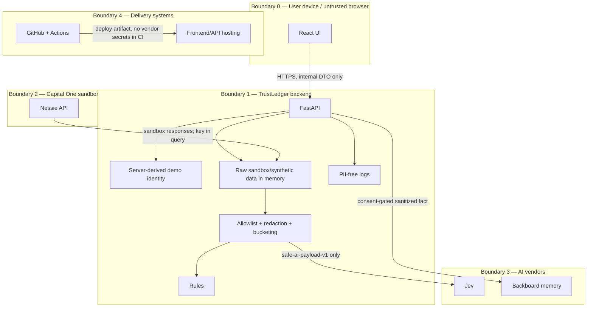

# TrustLedger 資安與隱私威脅模型

**範圍：** Technica 2026 B2C MVP  
**方法：** 資產/信任邊界 + STRIDE + AI/Memory 特有風險  
**前提：** 僅 synthetic/Nessie sandbox data；單一 demo user；非正式金融系統

## 1. 安全目標

1. **最小揭露：** Jev/Backboard 只收到任務必要的抽象 features。
2. **秘密不離後端：** Nessie/Jev/Backboard key 永遠不進 browser、Git、log 或 screenshot。
3. **使用者控制：** confirmation 與 memory consent 分開；memory 可檢視/刪除。
4. **隔離：** browser 不能指定任意 user/account；Backboard assistant 不跨 demo users 共用。
5. **安全失敗：** vendor/network/schema failure 不造成資料外洩、不自動做金融處置，核心 rules-only Demo 可用。
6. **可驗證透明：** Privacy Inspector 顯示的 payload 就是實際 serializer 送出的 payload。

## 2. 非目標與不能做的宣稱

- 未完成 production authentication、KYC、account linking、multi-tenant authorization。
- 未完成 PCI DSS、GLBA、SOC 2、GDPR、CCPA、FFIEC 或銀行第三方風險管理。
- 未確認 vendor retention、training usage、data residency、subprocessors、DPA、breach SLA。
- 不是 fraud decision、付款/轉帳、信用/投資決策。
- TLS 只保護傳輸；vendor 執行推理時仍可能看到送出的明文 features，因此真正保護依賴 data minimization，不是「加密後 AI 就看不到」。

## 3. 系統、信任邊界與資產



可編輯來源：[diagrams/threat-boundaries.mmd](diagrams/threat-boundaries.mmd)。

### 關鍵資產

| 資產 | 風險 | MVP 控制 |
|---|---|---|
| Vendor API keys | 被盜用、費用、資料存取 | backend env/secret store、最小權限、rotate、no logs |
| Raw Nessie/synthetic records | 身分/行為重識別 | memory-only processing、no persistence/log、tokenization |
| Safe AI payload | 仍可能被組合重識別 | bucket/generalize、schema allowlist、最小歷史 |
| Confirmation | 被竄改造成錯誤記憶 | ownership、idempotency、server-side alert lookup |
| Backboard memory | 跨使用者洩漏、錯誤/過期 | per-user assistant、consent、summary/delete/retention |
| Model result | 誤導/過度自動化 | rules evidence、confidence、human review、no auto action |
| Git history/CI logs | 長期 secret 外洩 | ignore、push protection、mock-only CI、incident rotation |

## 4. 資料流與最小化

### 原始輸入（留在 backend）

```text
customer/account ids, names, address, original merchant/description,
precise amount/time, raw vendor response, API keys
```

### 可進 Jev 的唯一 schema

```text
merchant_category, amount_bucket, currency, local_day_part,
same_category_same_amount_24h_count, is_subscription,
subscription_delta_bucket, prior_user_confirmation
```

### 可進 Backboard 的內容

只有經 confirmation + consent 產生的抽象句子，例如：

```text
The demo user confirmed that two streaming-category charges in one day can be normal.
```

禁止：transaction/account/customer id、精確金額/日期、merchant display、姓名/聯絡資訊、raw JSON。

## 5. 威脅登錄

評分：Likelihood/Impact 為 Low/Medium/High；Residual 是完成 listed controls 後仍存在的風險。

### Identity、authorization、API

| ID | 威脅 / 攻擊路徑 | L/I | 必要控制 | 驗證 / Owner | Residual |
|---|---|---|---|---|---|
| T01 | **偽造 user id**：browser 傳 `user_id`/header 存取他人資料 | M/H | MVP 完全忽略 client owner id；server 固定 `demo-user-001`；正式版 OIDC subject | integration test 用任意 user header仍只得 demo scope / Backend | M：MVP 沒有真實 auth，必須標示 demo |
| T02 | **IDOR**：猜 transaction/alert/memory id | M/H | 每個查詢先以 current identity/assistant scope lookup；不存在與非 owner 都回相同 404 | other-owner fixtures、enumeration test / Backend+AI | L in single-user demo；正式多租戶需完整 authz |
| T03 | **Mass assignment**：confirmation body 偷塞 owner/memory id | M/M | strict schema、`additionalProperties=false`、server lookup resource | 422 tests / Backend | L |
| T04 | **Replay/double submit**：重複 confirmation/memory | H/M | in-flight UI disable、idempotent server、矛盾 decision 409；Jev optional Idempotency-Key | retry/double-click integration tests / Backend+Frontend | L |
| T05 | **CORS/CSRF confusion**：任意 site 呼叫 API | M/M | exact CORS origins；不使用 `*`+credentials；MVP 無 cookie auth；正式版加入 CSRF/session policy | allowed/denied origin tests / Backend | M：public unauthenticated demo仍可被呼叫，需 rate limit |

### Secret、transport、storage

| ID | 威脅 / 攻擊路徑 | L/I | 必要控制 | 驗證 / Owner | Residual |
|---|---|---|---|---|---|
| T06 | **前端 secret 洩漏**：`VITE_*`/bundle/source map 含 key | M/H | keys 只在 backend；前端 env allowlist；bundle/source scan | `rg` + built bundle scan / Frontend+Backend | L |
| T07 | **Nessie key 進 URL log**：query parameter 被 proxy/APM/history 記錄 | H/H | 禁記 query、sanitize http client exceptions、HTTPS、rotate if exposed | log capture assertions、review proxy config / Data+Backend | M：upstream contract 本身用 query key；仍需 vendor-side rotate |
| T08 | **Git/CI secret 洩漏**：`.env`、test recording、Actions echo | M/H | ignore、push protection、mock-only CI、no secrets on fork PR、minimal permissions | `git ls-files` check、secret scan、Actions review / Integrator | L/M：scanner pattern非完整 |
| T09 | **網路竊聽/MITM** | L/H | 所有外部連線 HTTPS/TLS、verify cert、禁止關閉驗證、平台 HTTP→HTTPS | config/code review、production curl headers / Backend | L；TLS 不防 vendor端明文處理 |
| T10 | **本機/資料庫殘留**：raw data或memory長期留存 | M/M | raw只在 function scope；synthetic-only SQLite；no raw cache；Demo 後 cleanup | filesystem/db inspection、cleanup record / Backend | L/M：vendor retention待確認 |

### AI、Privacy、Memory

| ID | 威脅 / 攻擊路徑 | L/I | 必要控制 | 驗證 / Owner | Residual |
|---|---|---|---|---|---|
| T11 | **敏感欄位送往 AI**：raw dict serialization 或 nested field 遺漏 | M/H | allowlist construction；recursive forbidden name/value validator；destination-specific DTO | property/unit snapshot tests / AI | L；safe features仍可能有重識別風險 |
| T12 | **Privacy Inspector 誤導**：UI 顯示假 payload，實際送另一份 | M/H | serializer output 同時餵 vendor + preview；禁止前端重建 | spy/mock assert exact object identity/equality / AI+Frontend | L |
| T13 | **重識別**：category+amount+time/history 組合唯一 | M/M | amount/time bucketing、category generalization、最小歷史、no user/account id | k-anonymity-style review不適用小 demo；manual payload review / AI | M：去識別≠匿名，pitch需承認 |
| T14 | **Prompt/data injection**：merchant/description包含指令 | M/M | raw merchant/description不送；bounded decision questions；no tool execution | adversarial fixture `ignore rules...` 不出 safe payload / AI+Data | L |
| T15 | **Model misinformation/overconfidence** | H/M | rules evidence、probability display、two-sided thresholds、human review、no automatic financial action | ambiguous response tests、UX copy review / AI+Frontend | M：模型仍會錯，需明確 limitation |
| T16 | **Memory poisoning**：惡意/誤點 confirmation 寫成永久偏好 | M/H | explicit consent、decision gate、abstract fact、可見/可刪、異常仍要求 review | no-consent/contradiction/delete tests / AI+Frontend | M：使用者可能誤確認 |
| T17 | **跨使用者 memory leakage**：多 users共用 assistant | M/H | MVP single demo user + dedicated assistant；禁止 client提供 assistant id；未來 per-user assistant | assistant ownership test/config assertion / AI+Backend | L in MVP；H if design被錯誤擴展 |
| T18 | **過期記憶**：舊偏好壓過新風險 | M/M | memory metadata/age、confirmation evidence、delete/update、memory只做 context不自動忽略 alert | stale-memory test / AI | M |
| T19 | **Vendor retention/training未知** | M/H | 只送 minimum synthetic-safe data；正式上線前 vendor privacy/DPA review；不宣稱 zero retention | checklist evidence / Project lead | M/H，因目前未核對政策 |

### Availability、integrity、supply chain

| ID | 威脅 / 攻擊路徑 | L/I | 必要控制 | 驗證 / Owner | Residual |
|---|---|---|---|---|---|
| T20 | **Vendor outage/rate limit** | H/M | timeout、有限 retry、circuit/degraded status、synthetic/rules fallback | 429/5xx/timeout tests / All backend owners | L for demo；award evidence可能受影響 |
| T21 | **Schema drift**：Nessie/Jev/Backboard response 改變 | M/M | strict parser、version/pin、mock contract tests、unknown→degraded | malformed/missing/additional field tests / Data+AI | M |
| T22 | **Resource exhaustion**：超大 body/repeated analyses | M/M | request size、validation、rate limit/cache、limit max100、no arbitrary prompt | boundary/load smoke / Backend | M：prototype rate limit可能簡化 |
| T23 | **Dependency/supply-chain compromise** | L/H | lock files、少依賴、official packages、CI clean install、no random copy-paste actions | dependency review、audit where available / All | M under time pressure |
| T24 | **CI/deploy compromise**：過寬 token、third-party action | L/H | GitHub permissions `contents:read`、official actions、pin verified versions、no vendor secrets CI、least-privilege deploy token | workflow review / Integrator | L/M |
| T25 | **Log tampering/repudiation** | L/M | request id、timestamp/status/provider/model version；append-only platform logs；無 PII | integration log assertions / Backend | M：prototype無完整 immutable audit |
| T26 | **Dangerous automated action**：模型結果觸發付款/封鎖 | L/H | 系統沒有 payment/block endpoints；human confirmation僅改本地狀態/memory | route inventory、negative tests / Backend | L |

## 6. Security controls by layer

### Frontend

- 不持有 vendor key；不直接 call vendors。
- 不持久化 raw financial response 到 localStorage/sessionStorage。
- UI 明確標 synthetic/live/degraded，避免 deception。
- confirmation consent 預設 false。
- memory delete 可用、狀態可見。
- 安全 copy 不把 alert 說成詐欺結論。

### FastAPI

- request schema deny unknown fields。
- server-derived identity/resource ownership。
- exact CORS、HTTPS、no-store、safe error envelope。
- centralized config/secret loading；startup validation。
- outbound clients timeout、bounded retry、schema validation。
- safe logging middleware 避免 body/query/headers。
- `/health` 不回 secret metadata。

### Data adapter

- raw response scope 最小，不落盤、不 log。
- Nessie key query redaction。
- canonical DTO tokenizes raw IDs。
- synthetic adapter 是可信 fallback；不偽標 live。

### AI layer

- allowlist DTO + recursive validator。
- merchant raw text不進模型，降低 injection。
- pinned Jev model version + recorded `model_version`。
- rules先行、human-in-loop、no automatic action。
- Backboard dedicated assistant + consent gate + delete。

### GitHub/CI/Hosting

- protected main、review、tests、push protection。
- CI 使用 mock，無 vendor secrets。
- least privilege workflow permissions。
- deploy secrets runtime injection，不在 image/build args。
- HTTPS、debug off、log retention短且無 PII。

## 7. 記憶保留與刪除政策（MVP）

| 資料 | 預設保留 | 刪除事件 | 方法 | Owner |
|---|---|---|---|---|
| Synthetic fixture | repo 內永久 | repo cleanup | Git PR | Data |
| Raw Nessie response | 只在 request function scope | request 完成 | 不 cache/不落盤 | Data/Backend |
| Canonical demo transactions | process/SQLite demo 期間 | Demo reset/活動後 | reset demo DB | Backend |
| Alerts/confirmations | 活動期間 | Demo reset/活動後 | reset demo DB | Backend |
| Jev payload/result | 不由 app永久保存；僅必要 result fields | Demo reset | 清 local records | AI/Backend |
| Backboard memory | 直到使用者刪除或活動結束 | UI delete、活動後 cleanup | official delete memory endpoint；確認 completion | AI |
| App logs | 盡量 24–72 小時；平台最短實用值 | retention到期/事件處理後 | host log policy | Backend |

**Vendor-side retention 未核對。** 活動後從 app刪除不等於 vendor backup/telemetry立即消失。正式版上線前必須取得 privacy policy/DPA/retention/data residency/subprocessor/training-use 答案。

### Demo 後 cleanup

- [ ] Backboard 列出 demo assistant memories，逐一刪除並確認 operation completion。
- [ ] 視需要刪除專用 assistant/threads；先確認不會刪他人資料。
- [ ] 撤銷臨時 Jev/Backboard/Nessie keys。
- [ ] 刪除 deploy preview environment/secrets。
- [ ] 刪除本地 demo DB/logs；保留純 synthetic fixture。
- [ ] 檢查 GitHub Actions artifacts/logs 無 secret。

## 8. 無 PII logging 規格

### Allowlist fields

```text
timestamp, level, request_id, route_template, method, status_code,
latency_ms, provider, provider_status, model_version,
payload_schema_version, error_class
```

### 明確禁止

```text
headers, cookies, query string, request/response body,
API keys/tokens, customer/account/transaction/alert/memory ids,
name/address/email/phone, merchant display, exact amount/time,
Backboard memory text, Jev state/answers distribution（除必要 aggregate）
```

測試用 log capture assertions 搜尋 fixture 中的 sentinel values：姓名、account token、merchant display、`sk-glm5-`、`key=`。若 logging library 預設記 URL，改記 route template。

## 9. Security test matrix

| Test | Gate | 預期 |
|---|---|---|
| Recursive safe payload scan | PR required | forbidden keys/values 0 命中 |
| Browser bundle secret scan | PR required | vendor secret 0 命中 |
| Git tracked env check | CI required | only example env files tracked |
| Nessie exception/log test | PR required | key/query/raw ids 0 命中 |
| Jev malformed/timeout/429 | PR required | rules-only/degraded，不洩漏 body |
| Backboard no-consent | PR required | 0 memory calls |
| Cross-assistant memory id | PR required | safe 404/denied |
| IDOR transaction/alert | PR required | same safe 404 |
| CORS disallowed origin | integration | no permissive response |
| Duplicate confirmation | integration | idempotent/409 defined |
| Offline full Demo | release gate | end-to-end完成 |
| Keyboard/privacy delete | release gate | core flow可完成 |

## 10. Incident response（黑客松版）

### Secret exposed

1. 立即 revoke/rotate（第一步）。
2. 切 synthetic/rules-only/off，保持 Demo。
3. 檢查 Git/PR/Actions/logs/screenshots。
4. 移除 history 和 artifacts；通知隊友重新 sync。
5. 記錄受影響 key、時間、可能曝光位置；不在公開 issue貼值。

### Possible cross-user data/memory leak

1. 關 `ALLOW_MEMORY_WRITE`、停 live memory。
2. 撤銷 Backboard key或隔離 assistant。
3. 清查 threads/memories；不要擴大讀取範圍。
4. 改用 local fallback，對評審誠實說明。

### Vendor schema/outage

1. 不無限重試。
2. health 切 degraded；使用 synthetic/rules。
3. 保存只含 status/time/endpoint name 的證據。
4. 只有官方 docs/mentor確認後才更新 adapter。

## 11. Release security gate

- [ ] 只使用 synthetic/Nessie sandbox；無真實金融資料。
- [ ] 前端、Git、CI、logs、screenshots 無 secrets。
- [ ] outbound allowlist/recursive scan tests green。
- [ ] key 僅 backend secret store；TLS verification on。
- [ ] CORS exact；identity/resource ownership server-derived。
- [ ] Memory consent off by default；list/delete可用；assistant不跨使用者。
- [ ] Vendor failures、安全 error、offline fallback 都測過。
- [ ] UI/pitch不做 fraud/compliance/zero-risk宣稱。
- [ ] AI 使用 credit 已寫入 README/Devpost。
- [ ] Demo 後 deletion/rotation owner 已指派。

## 12. 參考

- [OWASP Top 10 for LLM Applications 2025](https://owasp.org/www-project-top-10-for-large-language-model-applications/assets/PDF/OWASP-Top-10-for-LLMs-v2025.pdf)
- [Jev authentication](https://jev-ai.org/docs/authentication/)
- [Backboard authentication](https://docs.backboard.io/authentication)
- [Backboard memory](https://docs.backboard.io/concepts/memory)
- [GitHub push protection](https://docs.github.com/en/code-security/how-tos/secure-your-secrets/work-with-leak-prevention/push-protection-in-the-github-ui)
- [Nessie documentation](https://prod.nessieisreal.com/docs)

